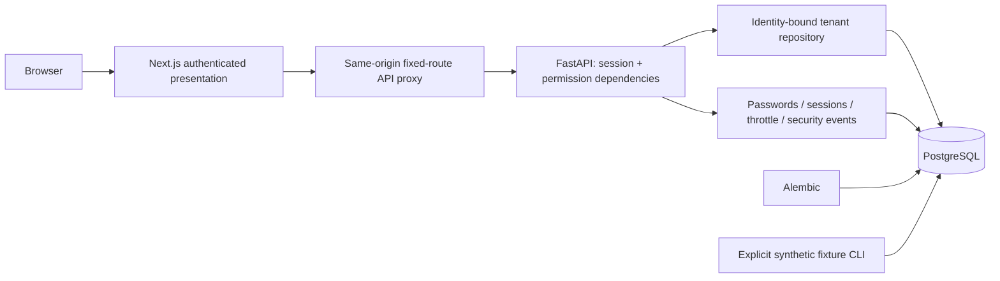

> Publication note: this inherited document records private-baseline phase evolution/evidence. Paths and commit references were sanitized. Current portfolio behavior is summarized in README and docs/portfolio; fresh-copy verification is in PHASE_13A. Historical source hashes are not a new certification of this sanitized snapshot.

# Architecture overview

Phase 1 extends the existing monorepo with authentication and tenant-scoped read access. The agent, tool registry, approval workflow and controlled business writes remain unimplemented.

FastAPI exposes public process health and database readiness, auth login/logout/me, and authenticated customer/account/ticket list/detail GET endpoints. No business mutation endpoint exists. Readiness is a bounded connectivity check, not a migration-currency check. API errors use strict standardized contracts and server-generated correlation IDs. Logs are JSON; raw request bodies, passwords and tokens are omitted. Connection/statement timeouts remain bounded, with pooled connection checks and shutdown disposal.

Next.js supplies the same-origin proxy, preserving Origin and HttpOnly Set-Cookie headers. The proxy allows only fixed route families, caps POST request bodies at 8 KiB and times out upstream requests. Browser data is loaded through authenticated APIs with no-store caching. Navigation uses server-returned permissions for presentation; backend dependencies are authoritative. Authentication state remains in memory, with the opaque token available only to the browser's cookie transport.

SQLAlchemy 2.x models and explicit Alembic revisions own schema changes. Migration `0002_authentication` upgrades Phase 0 without replacing business rows; it converts legacy approvers to reviewers while preserving IDs. Synthetic auth seeding is separate, explicit and blocked in production. Dependency locks and the existing three-service Compose foundation remain in use. Application containers use non-root users and loopback-bound published ports.

See [authentication](AUTHENTICATION.md), [authorization](AUTHORIZATION.md), [tenant isolation/RLS tradeoff](TENANT_ISOLATION.md) and [data model](DATA_MODEL.md). This foundation does not establish production readiness. Future deterministic agent state-machine stages and immutable execution auditing are not implemented by the Phase 1 security event store.

## Phase 2 tool boundary

The authenticated API and Tool Explorer delegate to a static, strict-schema read-only [tool registry](TOOL_REGISTRY.md). The executor revalidates sessions, applies permissions, creates an immutable context, uses tenant-scoped read-only transactions, validates bounded outputs and persists metadata in separate transactions. See [contracts](TOOL_CONTRACTS.md) and [security assumptions](TOOL_SECURITY.md). This boundary now supports the Phase 3/4 read-only orchestrator; no business writes are active.

## Phase 3 request-scoped orchestration

The Investigation Workspace calls authenticated investigation endpoints. A finite [state machine](AGENT_STATE_MACHINE.md) bounds the deterministic mock [planner/orchestrator](AGENT_ORCHESTRATION.md), which calls ToolExecutor directly. The executor rechecks current session and investigation permission for every call. Structured [evidence provenance](AGENT_EVIDENCE.md) supports advisory findings. Phase 4 replaces the original process-local store with PostgreSQL-backed owner-scoped history and checkpoints. No business writes, eligibility certification or approvals are enabled.

## Phase 4 durable lifecycle

[InvestigationRepository](INVESTIGATION_PERSISTENCE.md) owns tenant/actor-scoped, current-session-authorized lifecycle transactions. Five tables persist states, step definitions, [versioned checkpoints](CHECKPOINTS.md), events and evidence. Unique idempotency bindings, row versions, ordered sequences and database-time leases prevent lost updates and duplicate admission. [Explicit safe recovery](RECOVERY.md) restores counters/completed observations, rejects active leases and stops for review on ambiguous tools. Cancellation and results survive restart. PostgreSQL state is shared across application instances; execution remains request-scoped, without a distributed worker system or business writes.

## Phase 5 evidence retrieval

`EvidenceRetrievalService` wraps the same ToolExecutor dispatch path and normalizes each successful observation before its existing durable checkpoint transaction. Canonical sources are optional children in evidence JSON; typed reconciliation and links persist in the terminal result. Existing recovery uses saved sources without duplicate calls. Current policy search adds tenant/key effective-window version precedence and deterministic keyword ranking. See [retrieval](EVIDENCE_RETRIEVAL.md), [policy search](POLICY_SEARCH.md), [reconciliation](EVIDENCE_RECONCILIATION.md) and decision [0006](../decisions/0006-evidence-retrieval.md). No source content grants action authority.

## Phase 6 bounded dynamic planning

The same orchestrator now consumes strict [dynamic decisions](DYNAMIC_PLANNING.md), choosing follow-up reads and query terms from validated observations. Deterministic mock remains default; a disabled-by-default [OpenAI-compatible adapter](LLM_PLANNER.md) uses only a fixed configured endpoint and never bypasses executor authorization. [Operational traces](AGENT_TRACES.md), provider reservations and no-progress fingerprints are additive checkpoint/result JSON fields. Legacy v1 recovery retains original selection order; v2 recovery preserves completed reads and budgets. No new database migration, approval execution or Phase 7 action eligibility is introduced. Decision [0007](../decisions/0007-dynamic-planning.md) records integration choices.

## Phase 7: evaluation-only PDP

A static action catalog feeds strict proposals into the deterministic [Policy Engine](POLICY_ENGINE.md). Existing identity and canonical evidence remain authoritative. Tenant-scoped proposals and append-only [decision receipts](DECISION_RECEIPTS.md) record ALLOW, REQUIRE_APPROVAL or DENY; current status can also be STALE. [Catalog definitions](ACTION_CATALOG.md) are not registered execution tools. No business mutations, approval grants or action execution exist.

## Phase 8: human-controlled synthetic execution

The [approval state machine](APPROVAL_WORKFLOWS.md) separates proposal, independent review and execution. [Controlled execution](CONTROLLED_EXECUTION.md) reuses the PDP inside locked serializable transactions; [execution receipts](EXECUTION_RECEIPTS.md) bind verified local effects and durable replay keys. The agent and ToolRegistry remain read-only. No real enterprise mutation integration exists.

Phase 9 introduces PostgreSQL durable execution scheduling around the Phase 8 executor, with fenced leases, bounded retries, dead letters, cancellation and receipt reconciliation. Investigation leases remain independent. See [DURABLE_JOBS](DURABLE_JOBS.md), [WORKER_RELIABILITY](WORKER_RELIABILITY.md), [EXECUTION_RECONCILIATION](EXECUTION_RECONCILIATION.md) and [RETRY_POLICY](RETRY_POLICY.md).

Phase 10 replaces static overview counts with tenant/role-scoped operational read models and adds durable incident metadata, exact correlation tracing, alert thresholds and persisted worker observations. See [Operations Command Center](OPERATIONS_COMMAND_CENTER.md), [observability definitions](OBSERVABILITY.md), [incident runbook](INCIDENT_MANAGEMENT.md) and [correlation tracing](CORRELATION_TRACING.md). Incident response never changes business resources or retries jobs.

Phase 11 adds a development-only versioned red-team CLI over the existing real PostgreSQL integration tests and Phase 5–10 evaluation artifacts. It preserves all runtime authority boundaries and adds exclusive destructive-test database ownership, fresh failure-aware reports and mock-only HTTP safeguards. See the security threat model and decision 0012.

## Phase 12 local release tooling

Development-only release tooling coordinates serial checks and records fresh logs/status/durations. Separate stopped-worker cancellation and active-worker full browser cohorts use actual services. Dedicated marked demo reset replaces volume-wide deletion. Multi-stage nonroot backend runtime excludes uv/pip/test tooling; frontend standalone runtime excludes lint/build dependencies. Read-only latency and query diagnostics preserve their limited measurement scope. No schema, agent authority, approval bindings, worker policy or agent budgets changed. See [release evidence decision](../decisions/0013-local-release-evidence.md) and [local release status](../release/RELEASE_CANDIDATE.md).

The Phase 12 runtime investigation separates source-package matches from native-library exposure and supplemental vendor-SBOM findings. Frontend's official Node 26.12.0/Alpine 3.24 candidate carries OpenSSL 3.5.9 and removes unused JavaScript package managers; Current-channel lifecycle limits are explicit. Backend/worker keep their tested Python/Debian ABI and unresolved native-library findings. See [decision 0014](../decisions/0014-runtime-exposure-review.md) and [runtime review](../release/RUNTIME_REVIEW.md). No business workflow or authority boundary changes.
