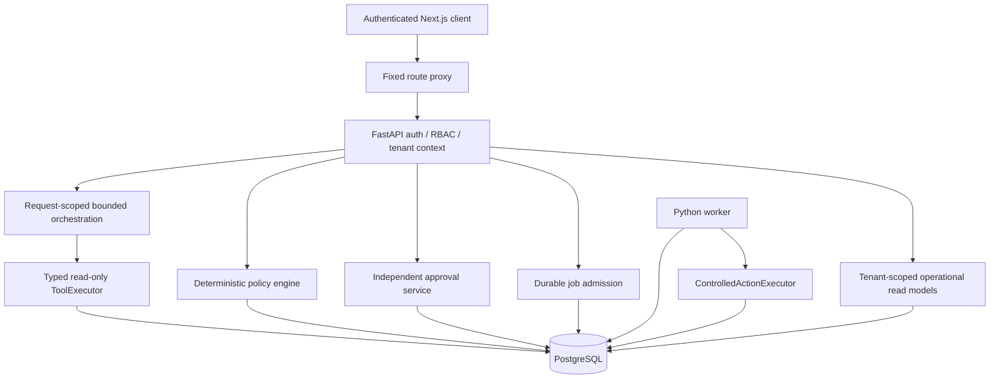
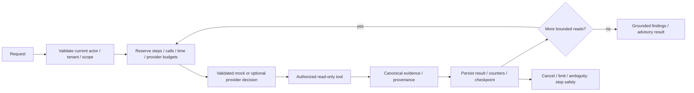
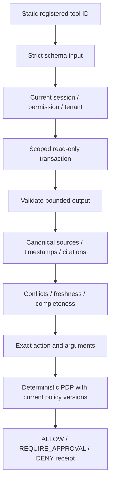
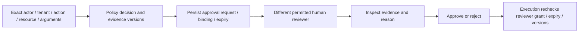
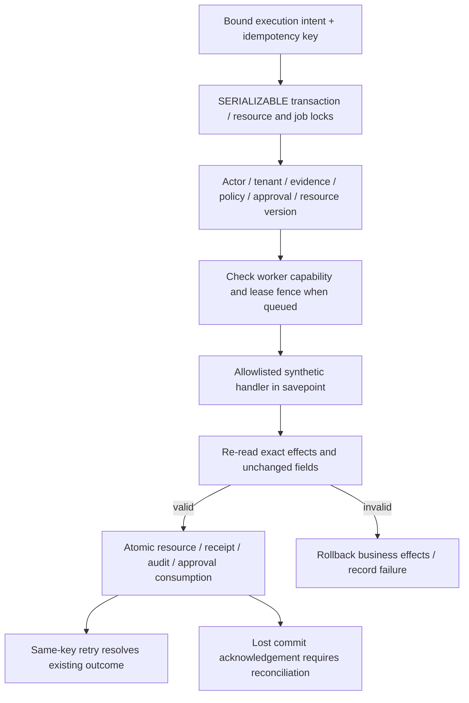
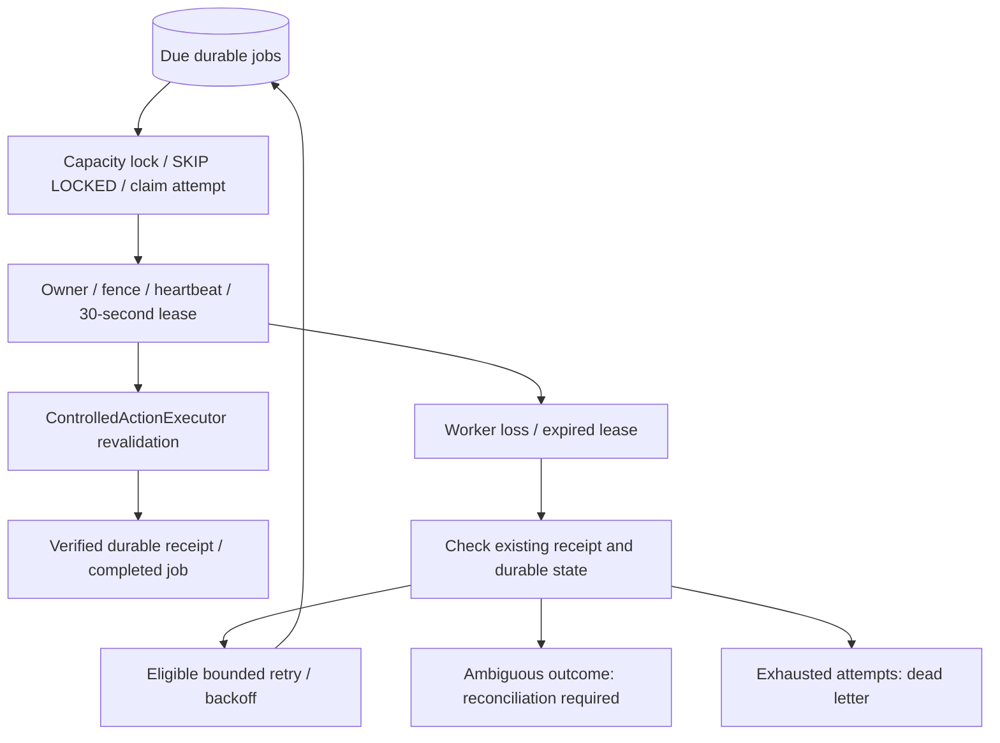
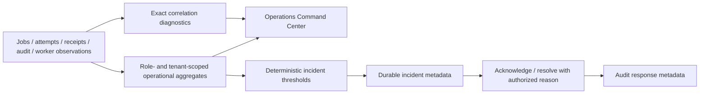

# Implementation architecture

These diagrams describe the implemented synthetic local application. AI planning never grants authorization; arrows do not imply an external customer integration.

## Overall system

## Investigation lifecycle

## Tool execution, evidence and policy

Tool timeouts, bounded outputs and no-progress limits constrain investigation. Source text is untrusted data, never an approval. Policy search supports retrieval; deterministic executable policy owns eligibility.

## Human approval

Some allowlisted low-risk actions can be allowed without approval; approval requirements come from deterministic policy, not the model. The executor remains authoritative even after approval.

## Controlled business execution

No external write integration exists. DB-level idempotency and transactional atomicity do not establish exactly-once network effects.

## Durable worker recovery

Four global and one per-tenant admissions bound concurrency; one process handles one job at a time. Graceful shutdown drains bounded work. Recovery does not bypass an expired approval or stale evidence.

## Operations and incidents

Resolving an incident does not repair a business resource, grant authority or authorize replay. See [implementation documents](../architecture/OVERVIEW.md) for historical phase evolution and [runtime limitations](../release/RUNTIME_REVIEW.md).
